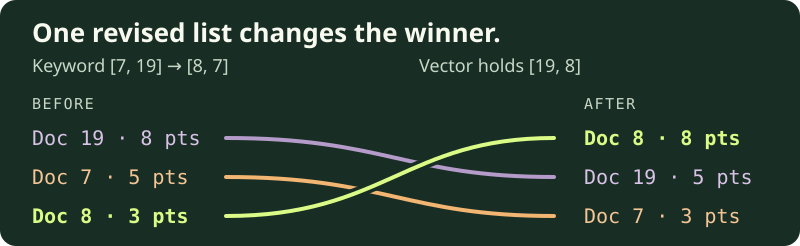

# RankPatch

**Keep search results ranked as workers revise them.**

RankPatch is an in-process C++17 and Python library for incremental top-k rank fusion. Put one index in the coordinator for each live query. Keyword, vector and reranking workers send it ordered document IDs. After each update, your search UI or RAG context builder can read the current winners and their scores.

[Try a revision in the browser](https://huggingface.co/spaces/pgg-engineering/rankpatch) · [Install RankPatch](#try-it) · [Connect a retriever](integrations/hybrid/README.md)



**742 ns** median to replace a 32-document list and read the top ten in the single-threaded C++ benchmark with 1,024 sources and a 131,072-ID universe. The fastest tested alternative in that case took 2,003 ns. An indexed heap won on the progressive SciFact replay. These timings cover the local fusion step. [Timing matrix](bench/README.md) · [SciFact replay](replay/README.md)

## Try it

Install a prebuilt wheel for CPython 3.11–3.13 on Linux x86-64 (glibc 2.28+), Apple Silicon (macOS 11+) or Windows x86-64. This installs the package directly from the GitHub release.

```sh
python -m pip install --no-index --only-binary=:all: --find-links https://github.com/pgg898200-ship-it/rankpatch/releases/expanded_assets/v0.1.0 rankpatch==0.1.0
```

For C++17, copy [rankpatch.hpp](include/rankpatch.hpp) for buffered updates or [rankpatch_steady.hpp](include/rankpatch_steady.hpp) for the indexed heap. Each header stands alone. For other Python source builds, install the [source distribution](https://github.com/pgg898200-ship-it/rankpatch/releases/download/v0.1.0/rankpatch-0.1.0.tar.gz) with a C++17 compiler, CPython development headers and pip. From a checkout, use `python -m pip install .`.

```python
from rankpatch import Index

index = Index(sources=2, universe=100, rank_points=[5, 3, 1], k=2)
index.replace(0, 0, [7, 19])     # first page
index.replace(1, 4, [19, 8])     # vector worker
assert index.top() == [(19, 8), (7, 5)]
index.replace(0, 1, [8, 7])      # keyword worker revises its list
assert index.top() == [(8, 8), (19, 5)]
assert not index.replace(0, 0, [7, 19])  # late delivery
index.replace(1, 5, [])          # withdraw worker 1
assert index.top() == [(8, 5), (7, 3)]
```

### Replay a stream of updates

From a checkout with RankPatch installed, this command plays seven example messages through the Python API. Each input line contains a source ID, a revision number and the complete ranked list. The last line replays an older revision. Its `applied` flag is false and the three winners keep their scores.

```sh
python examples/live_search.py --stdin < bench/your_trace/example.jsonl
```

```json
{"source":0,"revision":1,"applied":false,"top":[[5,8],[7,6],[2,3]]}
```

| To connect it to | Start here |
|---|---|
| Concurrent search workers sending JSON Lines | [Stream messages into one coordinator](examples/live_search.py) |
| A LangChain retriever or RAG context builder | [Fuse ranked Document IDs and return the original Documents](integrations/hybrid/README.md#langchain-retrievers) |
| SQLite FTS5 or scikit-learn nearest neighbors | [Use string document IDs with `rankpatch.catalog` from a source install](integrations/hybrid/README.md) |
| A coding agent | [API contract, integration recipes and evidence](llms.txt) |

To reproduce a fused ranking, store each source’s revision and payload along with the rank-point table and ID mapping.

## Scoring and integration contract

| Input | Contract |
|---|---|
| Source | Fixed integer ID in `[0, sources)`. Use one index per independently fused query. |
| Document | Dense integer ID in `[0, universe)`. Keep the ID mapping stable while the index is live. |
| Payload | Whole ordered list of distinct documents. An empty list retracts all contributions from that source. |
| Revision | Unsigned 64-bit integer, strictly increasing within a source. Zero is a valid first revision. Retries and older deliveries return false. |
| Score | Document at zero-based position i contributes `rank_points[i]` to its total. Points are positive 32-bit integers. Totals are unsigned 64-bit. Shorter lists use the same prefix of weights. |
| Output | Up to k active documents, higher score first, smaller document ID first on ties. C++ returns a borrowed reference. Python returns a snapshot. |

Integer Borda weights such as `[3, 2, 1]` are exact. Integer approximations to reciprocal rank use the stated rounding rule and can differ from mathematical RRF. The index needs one writer or external synchronization. A coordinator can own the index while workers send revision messages. Retrieval, transport, persistence and worker scheduling belong to the calling application.

## How the update works

RankPatch stores a ballot per source and a score per document. A replacement combines the old and new contribution before changing the score. An adjacent swap of a previously validated ballot only changes two scores. The index keeps extra candidates around the top-k boundary and tracks the score and ID that a challenger must beat. A change below that boundary can leave the cached result valid. When too few candidates remain, the next read rescans active documents. This is an implementation of a well-established materialized top-k idea. [Yi et al., ICDE 2003](https://cse.hkust.edu.hk/~yike/topk/)

Replace takes O(old length + new length). An unchanged cached result can be read in O(1) in C++. A refresh over C candidates takes expected O(C + k log k). A refill can inspect every active ID, including on consecutive adversarial reads. Python additionally materializes up to k output tuples. Dense score and position arrays require about 20 bytes per configured document ID **before** source ballots, candidate buffers and result storage. Map sparse external IDs before allocating an index.

## Choosing a strategy

Use the default `strategy="buffered"` for frequent small edits, especially with many independent sources and limited overlap. Use `strategy="steady"` when entire groups of leading documents may disappear together. The steady strategy keeps the winners sorted and the remaining documents in an indexed heap, so a withdrawal can promote the next document directly. It also preserves the API, tie order and score contract. In C++, construct `rankpatch::SteadyIndex` for this behavior. Choose a strategy when creating the index. [Compare both strategies on your own JSONL trace](bench/your_trace/README.md) to measure p50 and p99 locally. The comparison report contains no document IDs.

The [65,536-source stress test](bench/stress/README.md) exercises both random replacements and sustained withdrawal of tied leaders. Each measurement uses one process with 65,536 logical sources. This test includes p99.9, peak RSS, event hashes and independent full-rebuild checkpoints.

## When to choose it

| Workload | Evidence |
|---|---|
| Many active sources revise or retract short lists; clients read after each update | RankPatch at 1,024 dilute-overlap sources took 742 ns p50 / 1,482 ns p99 for replacements, and 510 ns / 1,222 ns for retraction or restore. |
| Small fan-in, single final merge | A rebuild is simple and sometimes faster. Four-source dilute replacements measured 851 ns p50 for a rebuild and 981 ns for RankPatch. |
| Short pages that only grow | On our SciFact progressive replay, the indexed heap averaged 203 ns per update/read versus 287 ns for RankPatch. |
| Existing service needs durability or cross-process transactions | SQLite and streaming databases provide capabilities outside the in-process kernel. The SciFact replay includes an in-memory, prepared-statement SQLite comparator. |

The [Python comparison with RankOps 0.1.26](bench/rankops/README.md) uses released packages, Borda scoring and the same SciFact list contents. With a prebuilt dense-ID mapping for RankPatch, updating and reading after each progressive delivery took 1.50 µs with the steady strategy and 10.93 µs with RankOps native top-10. RankOps was faster for a cold one-shot merge starting from string IDs. The comparison also checks the two libraries’ different tie-ordering rules.

The synthetic matrix covers 18 scenarios. An exact oracle checked 442,368 timed snapshots. The SciFact replay uses actual document order from six retrieval methods and models delivery order. Both measure local reducer work. Neither run measures end-to-end search latency or relevance. [Machine-readable synthetic results](bench/results.csv) · [Replay measurements](replay/measurement.json)

## Verify

```sh
c++ -O2 -std=c++17 tests/test.cpp -o /tmp/rankpatch-test
/tmp/rankpatch-test
python -m unittest discover -s tests -p 'test_python.py'
python examples/live_search.py
```

To report a replication, open a [GitHub issue](https://github.com/pgg898200-ship-it/rankpatch/issues) with source count, list length, overlap, edit pattern, k, CPU/compiler and the raw timings for all implementations. Small, losing and tie-heavy workloads are welcome. Redacted ID-only traces are sufficient.

Original code is Apache-2.0. The derived SciFact fixture retains CC BY 4.0. [Code license](LICENSE) · [Data attribution](replay/README.md)
